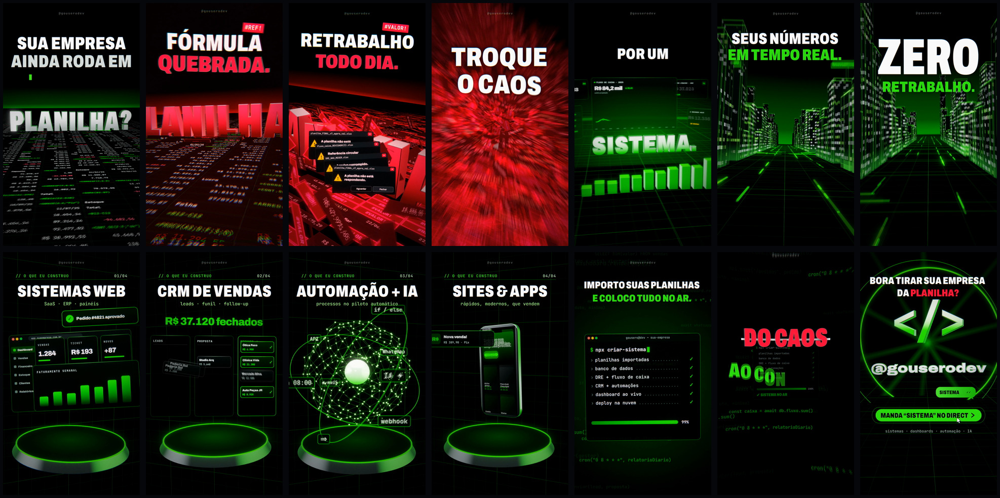

# InstagramVideos · @gouserodev

Reels em **motion 3D** feitos 100% em código: Three.js (WebGL) renderizado quadro a quadro em
Chromium headless → ffmpeg. A trilha e o sound design também foram sintetizados do zero (numpy).

---

## 🎬 Reel #1 — “Planilha → Sistema” (30 s · 9:16 · 1080×1920)



| Arquivo | Para quê |
|---|---|
| `reels/planilha-para-sistema/out/planilha-para-sistema-30fps.mp4` | **Postar no Reels** — 30 fps com motion blur real de 2 sub-quadros (47 MB, 12 Mbps, AAC 320k) |
| `reels/planilha-para-sistema/out/planilha-para-sistema-60fps.mp4` | Master 60 fps, ultra fluido (49 MB) |
| `reels/planilha-para-sistema/out/capa.png` | Capa do Reels (o gancho “SUA EMPRESA AINDA RODA EM PLANILHA?”) |
| `reels/planilha-para-sistema/out/storyboard.jpg` | Storyboard com os 14 momentos-chave |
| `reels/planilha-para-sistema/audio/soundtrack.wav` | Trilha original (128 BPM, loop perfeito, -1 dBTP) |

### A ideia (feita para virar cliente)

Fala direto com quem paga: o dono de empresa que **ainda roda tudo em planilha**. O vídeo mostra a dor,
vira a chave no *drop* e entrega a solução — com o seu @ e um CTA de palavra-chave no direct.

| Tempo | Beat | Cena | O que acontece |
|---|---|---|---|
| 0,0 s | B0 | **Gancho** | Close numa célula `=SOMA(B2:B9)`, a câmera puxa de cima: **“SUA EMPRESA / AINDA RODA EM”** (slam) |
| 0,9 s | B2 | Crane | A câmera mergulha e **“PLANILHA?”** em cromo 3D brota da planilha (molas letra a letra) · `// ctrl+c · ctrl+v · e reza` |
| 3,75 s | B8 | **Caos** | Onda de `#REF!` `#N/D` `#VALOR!` vira as células, tudo fica vermelho, células descolam: **“FÓRMULA QUEBRADA.”** |
| 4,7 s | B10 | | **“RETRABALHO TODO DIA.”** + janelas “A planilha não está respondendo” (`planilha_FINAL_v7_agora_vai.xlsx`) |
| 5,6 s | B12 | | **“DINHEIRO ESCAPANDO.”** + contador `R$ -48.392,17` |
| 6,6 s | B14 | **Vórtice** | **“TROQUE / O CAOS”** — o caos inteiro vira uma espiral e é sugado para um ponto → silêncio |
| 7,5 s | B16 | **DROP** | Flash + onda de choque: **“POR UM / SISTEMA.”** neon gigante, vertigo reverso revelando o dashboard (fluxo de caixa, DRE, KPIs contando, barras 3D) |
| 9,4 s | B20 | | **“FEITO SOB MEDIDA / PRO SEU NEGÓCIO.”** |
| 11,25 s | B24 | **Cidade de dados** | Voo rasante a ~40 u/s entre torres (janelas = dados), pacotes de luz, métricas flutuando: **“SEUS NÚMEROS / EM TEMPO REAL.”** |
| 13,1 s | B28 | | Curva chicote de 90° + **“ZERO / RETRABALHO.”** (callback da dor) |
| 15 s | B32 | **Serviços** | Elevador vertical por 4 pódios, troca no beat: **SISTEMAS WEB** (app explodido) · **CRM DE VENDAS** (kanban fechando negócios) · **AUTOMAÇÃO + IA** (esfera neural) · **SITES & APPS** (celular 3D + notificações) |
| 22,5 s | B48 | **Deploy** | **“IMPORTO SUAS PLANILHAS / E COLOCO TUDO NO AR.”** + terminal de vidro: `npx criar-sistema` → planilhas importadas ✓ … → **✔ SISTEMA NO AR** |
| 24,8 s | B53 | | **“~~DO CAOS~~ / AO CONTROLE.”** → zoom **através do “O”** para a cena final |
| 26,25 s | B56 | **CTA** | **@gouserodev** em cromo 3D (letras voando), marca `</>`, halo · **“BORA TIRAR SUA EMPRESA DA PLANILHA?”** · botão **MANDA “SISTEMA” NO DIRECT** é clicado → balão de DM enviado |
| 29,8 s | B63.5 | Loop | Flash branco que emenda no slam inicial — o Reels repete sem costura (mais retenção) |

### Técnicas de motion usadas

- **3D de verdade (WebGL/Three.js):** planilha instanciada com ~3.900 células animadas na GPU, cidade com ~2.900 torres
  e janelas procedurais, texto 3D extrudado com bevel, esfera neural com pulsos percorrendo as conexões, celular 3D.
- **Câmera cinematográfica:** crane, órbita, dolly-in/out, **vertigo reverso** (lente 98° → 46°), whip pans,
  "elevador" vertical, curva chicote, mergulho; shake procedural por impacto.
- **Motion blur físico:** derivado da velocidade angular/linear da câmera (obturador de 180°) + versão 30 fps com média de sub-quadros.
- **Tipografia cinética:** slam com blur, máscara com stagger, digitação, glitch RGB, risco animado, zoom-through numa letra.
- **Partículas na GPU** (explosão do drop, faíscas, poeira), onda de choque no piso, streak anamórfico, halo e raios.
- **Pós-processamento próprio:** bloom dual-filter, aberração cromática, glitch, punch de lente, ACES, grade de cor,
  vinheta, scanlines, grão/dither (evita banding na compressão do Instagram).
- **Tudo no beat (128 BPM):** 16 compassos = 30,0 s; cada corte, impacto e pulso cai na grade musical.
- **Trilha + sound design sintetizados:** kick/clap/hats, sub com sidechain, supersaw, arpejos, risers, impacts, whooshes,
  glitches, digitação, "caixa registradora" no CRM, pings de notificação — masterizado a -10 LUFS / -1 dBTP.

### Kit de postagem

**Legenda**

```
Sua empresa ainda roda em planilha? 📊😵‍💫

Fórmula quebrada, retrabalho todo dia e dinheiro escapando sem você perceber.

Eu transformo esse caos em um sistema feito sob medida pro seu negócio:
✅ Dashboard com seus números em tempo real
✅ DRE e fluxo de caixa automáticos
✅ CRM de vendas + automações (WhatsApp, e-mail e IA)
✅ Sistemas web, sites e apps

👉 Manda “SISTEMA” no direct que eu te mostro como ficaria na sua empresa.

#sistemas #automacao #inteligenciaartificial #dashboard #fluxodecaixa #gestaoempresarial
#empreendedorismo #pequenasempresas #planilha #excel #crm #saas #desenvolvimentoweb #programador #devbrasil
```

**Comentário fixado:** `Quer ver como ficaria na sua empresa? Manda SISTEMA no direct 👇`

**Dicas**
- Suba a versão **30 fps** (mais compatível com a compressão do Instagram); use `capa.png` como capa.
- Deixe o áudio original do vídeo (é sincronizado com cada corte). Se quiser usar música em alta, baixe o volume dela e mantenha os efeitos.
- Se usar automação de DM (ManyChat etc.), configure a palavra-chave **SISTEMA**.

---

## 🎥 Vídeo #2 — Teste CGI + Motion sobre vídeo real (37,5 s · 9:16 · 1080×1920)

Vídeo gravado no carro (`reels/video-cgi-teste/data/original.mp4`) em que o próprio roteiro falado dá as instruções
de edição. A transcrição (Whisper large-v3, `data/words.json`) virou a linha do tempo dos efeitos:

| Fala | Tempo | O que foi feito |
|---|---|---|
| “Esse é um vídeo de teste para o Cloud e outras IAs” | 0,3–4,4 s | vídeo limpo (só grade leve + grão) |
| “Aqui atrás tem uma **legenda**, com tudo que eu tô falando, **atrás da minha cabeça**” | 5,8–10,0 s | legenda cinética em 3D **atrás da cabeça**: o texto segue o topo da cabeça e a máscara (matte) da pessoa cobre as letras; a palavra falada acende em verde |
| “Aqui tem uma **mágica**, qualquer uma que seja” | 12,3–15,8 s | orbe de plasma + círculo rúnico girando acima do dedo (rastreado), faíscas orbitando, luz colorida no ambiente |
| “…**puxando e concentrando a mágica** e **lançando ela na tela**” | 16,8–22,6 s | a mão “puxa” a energia (rastro), partículas convergem, relâmpagos, anéis contraem, orbe cresce na palma; no gesto final o orbe é **lançado na câmera** |
| “Aqui a gente **teleportou**, tá **no meio do espaço**” | 22,8–28 s | flash + onda de choque → **portal** que revela o espaço com salto hiperespacial; estrelas, nebulosa, planeta com anéis; a pessoa é re-iluminada pelo cenário |
| “Teleportou com um **buraco negro** que apareceu” | 28,3–31,9 s | **buraco negro** com lente gravitacional real (traçado de raios), disco de acreção com efeito Doppler e onda no espaço-tempo; colapsa no fim |
| “E agora, uma **Supernova** atrás de mim” | 32,5–37,5 s | estrela instável → **explosão** (flash, casca de gás, filamentos, raios, detritos, onda de refração) com a pessoa em contraluz |

Extras: **sound design** sintetizado (numpy) sincronizado com cada efeito e com *ducking* sob a voz, mixado com o áudio original.

**Arquivos** (`reels/video-cgi-teste/out/`): `video-cgi-teste.mp4` (com SFX), `video-cgi-teste-sem-sfx.mp4` (só a voz original) e `storyboard.jpg`.

**Como foi feito** (tudo em código, sem editor de vídeo):

1. `prep/matte.py` — recorte da pessoa quadro a quadro com *Robust Video Matting* (ONNX) → `matte/%05d.png`
2. `prep/track.py` + `prep/smooth.py` — MediaPipe (mão, rosto, pose) → `data/track.json` (âncora do orbe e da legenda)
3. `main.js` + `shaders.js` + `world.js` + `fg.js` + `captions.js` — compositor WebGL2 (Three.js): vídeo → mundo (espaço/BH/SN) → legenda → **pessoa (matte)** → luz/rim → mágica → bloom/grade
4. `tools/vfx.mjs` — renderiza quadro a quadro em Chromium headless (SwiftShader) e monta o MP4
5. `audio/sfx.py` — efeitos sonoros + mixagem

```bash
# pré-processamento (gera os quadros e as máscaras num diretório de trabalho, ex.: /tmp/vfx-work)
mkdir -p /tmp/vfx-work/footage
ffmpeg -i reels/video-cgi-teste/data/original.mp4 -vf "hqdn3d=2.5:2.5:6:6,scale=1080:1920:flags=lanczos,unsharp=5:5:0.45:5:5:0.0" -q:v 2 -start_number 1 /tmp/vfx-work/footage/%05d.jpg
python3 -I reels/video-cgi-teste/prep/matte.py reels/video-cgi-teste/data/original.mp4 rvm_resnet50_fp32.onnx /tmp/vfx-work/matte 1.0
python3 -I reels/video-cgi-teste/prep/track.py reels/video-cgi-teste/data/original.mp4 <pasta_dos_modelos_mediapipe> /tmp/vfx-work/track.json
python3 -I reels/video-cgi-teste/prep/smooth.py /tmp/vfx-work/track.json reels/video-cgi-teste/data/track.json

# revisar quadros avulsos / renderizar / montar
node tools/vfx.mjs stills --work /tmp/vfx-work --out /tmp/stills --t 6.9,14.5,22.5,29.8,35
node tools/vfx.mjs render --work /tmp/vfx-work --workers 2
python3 -I reels/video-cgi-teste/audio/sfx.py reels/video-cgi-teste/data/original.mp4 /tmp/vfx-work/mix.wav
node tools/vfx.mjs final --work /tmp/vfx-work --audio /tmp/vfx-work/mix.wav --out reels/video-cgi-teste/out/video-cgi-teste.mp4
```

Todos os tempos dos efeitos ficam em `reels/video-cgi-teste/timeline.js` (e as posições do cenário em `state.js`) — dá para
ajustar qualquer momento e re-renderizar só aquele trecho (`--from/--to` em segundos + `--force`).

---

## ▶️ Preview ao vivo e render

```bash
npm install
npm run dev          # http://localhost:5173/reels/planilha-para-sistema/  (espaço = play, ←/→ = quadro a quadro)
npm run audio        # regera a trilha (requer python3 + numpy + scipy)
npm run render       # renderiza 1080×1920 @60 fps e gera as versões 60/30 fps com áudio (requer ffmpeg)
```

- Render por blocos com cache em `render-cache/`: para refazer só um trecho,
  `node tools/render.mjs reels/planilha-para-sistema --from 7 --to 12 --force`.
- Quadros avulsos para revisão: `node tools/still.mjs reels/planilha-para-sistema /tmp/frames 1.5 7.6 27`.
- Sem GPU (servidor/CI) roda em SwiftShader (~1,2 s/quadro); no navegador com GPU o preview roda em tempo real.

### Personalizar

Tudo que é marca e texto fica em `reels/planilha-para-sistema/config.js`:
paleta (`C`), fontes (`F`), roteiro (`COPY`) e o @ (`HANDLE`). A paleta segue o estilo dos projetos
(preto profundo `#020304`, verde toxic `#39ff14`, vermelho `#ff003c`) — troque e renderize de novo.

## Estrutura

```
engine/                     motor reutilizável para próximos reels
  core/time.js              easing (bezier/expo/mola), keyframes, grade de BPM
  core/random.js            aleatoriedade determinística + ruído para shake
  camera.js                 câmera como função do tempo + motion blur derivado
  stage.js                  shots, HUD separado (sem blur), FX acumulados por quadro
  gfx/post.js               bloom, blur direcional/zoom, CA, glitch, ACES, grão…
  gfx/text2d.js · text3d.js tipografia 2D (canvas→GPU) e 3D extrudada
  gfx/materials.js          matcaps de estúdio procedurais + material cromado
  gfx/particles.js · grid.js
  player.js                 preview com áudio/scrub + API de render quadro a quadro
reels/video-cgi-teste/       CGI + motion sobre vídeo real (compositor WebGL, matte, tracking, SFX)
reels/planilha-para-sistema/
  config.js                 paleta, fontes, roteiro
  shots/s1…s6               as 6 cenas + overlay
  lib/                      planilha instanciada, UI procedural (dashboard, kanban, celular…), estilos
  audio/soundtrack.py       trilha + SFX sintetizados
tools/                      servidor, render (Playwright + ffmpeg), stills
assets/fonts/               Archivo + JetBrains Mono (SIL OFL 1.1)
```

Fontes: [Archivo](https://github.com/Omnibus-Type/Archivo) e [JetBrains Mono](https://github.com/JetBrains/JetBrainsMono), ambas sob SIL Open Font License 1.1 (licenças em `assets/fonts/`).
